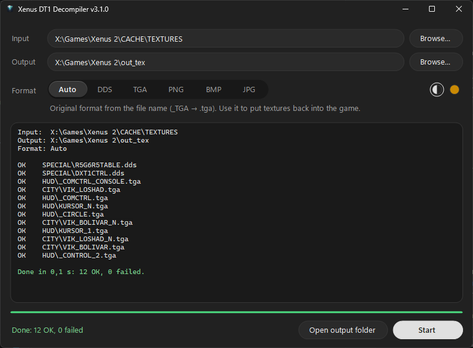
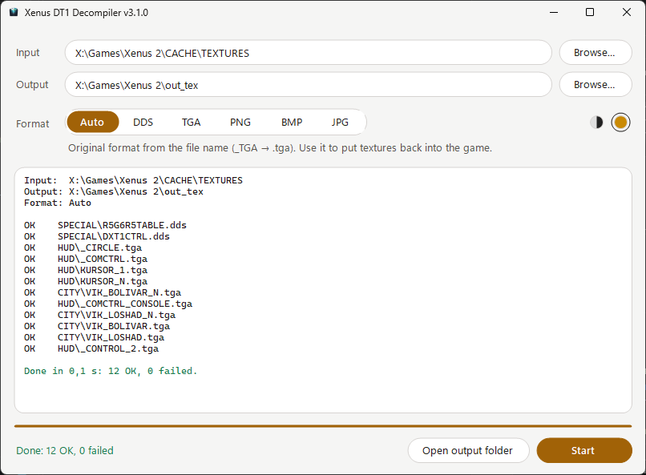

# Xenus DT1/DT2 Decompiler

[](../../releases/latest)
[](https://www.microsoft.com/windows)
[](https://dotnet.microsoft.com/download/dotnet/8.0)
[](https://github.com/CodeNoob53/xenus-dt1-decompiler/blob/main/LICENSE)
[](https://github.com/CodeNoob53/xenus-dt1-decompiler)

**English** | [Українська](README_UA.md) | [Español](README_ES.md)

Extracts textures from the cache of **Xenus 2: White Gold**, **Boiling Point: Road to Hell** and **The Precursors** (`*.DT1`) into `.tga`, `.dds`, `.png`, `.bmp` or `.jpg`, keeping the original folder structure.

Nothing to install: .NET is built into the exe, and no game files or DLLs are needed. Requires 64-bit Windows 10 or 11.

---

## Quick start

1. Download the latest archive from **[Releases](../../releases/latest)** and extract it.
2. Run `xenus-dt1-decompiler.exe`, pick the game's `CACHE\TEXTURES` folder and click **Start**.

---

## Supported games

| Game | Status |
|---|---|
| Xenus 2: White Gold | ✅ Tested on the whole cache (3829 textures) |
| Boiling Point: Road to Hell | ✅ Tested on the whole cache (2603 textures), since v3.0.2 |
| The Precursors | ⚠️ Not tested since v3.0 |

Up to v2.x, textures were decoded by the game's own `VELoader.dll`, so the tool worked with every game whose DLL it was given, The Precursors included. Since v3.0 the tool uses its own decoder, rebuilt from `VELoader.dll`; on Xenus 2 and Boiling Point its output is byte-identical to the DLL's. The Precursors runs on the same engine, so it should work too, but nobody has checked it yet. If you try it, please share the result in [#4](https://github.com/CodeNoob53/xenus-dt1-decompiler/issues/4), whether it works or not. If it fails, [v2.2.1](https://github.com/CodeNoob53/xenus-dt1-decompiler/releases/tag/v2.2.1) with the game's `VELoader.dll` remains an option.

---

## Getting the cache files

The game keeps its assets in `.grp` archives. If the game folder has no `CACHE\TEXTURES` with `.DT1` files, unpack the archives with **GrpUnpacker**. It comes with the Vital Engine SDK and is also distributed separately; some antivirus programs flag it, which is common for old modding tools.

Unpacking is also required to put edited textures back into the game (see [Modding](#modding-putting-textures-back-into-the-game)).

---

## Usage

### GUI

Run `xenus-dt1-decompiler.exe` without arguments.

1. **Input**: the folder with `.DT1` files, e.g. `Xenus 2\CACHE\TEXTURES` (subfolders are included), or a single `.DT1` file. You can also drop a folder or a file onto the window.
2. **Output**: where to save the textures. Defaults to `out_tex` next to the exe.
3. **Format**: pick one on the switch; hover over an option for details. See [Formats](#formats).
4. Click **Start**. The progress bar and the log show each file; **Cancel** stops the run, and **Open output folder** opens the result.

The paths and the format are remembered between runs. There are two themes, **Mono** and **White Gold**: pick one with the round swatches at the right of the Format row. Both follow the Windows light or dark mode.

| Mono, dark mode | White Gold, light mode |
|---|---|
|  |  |

### Command line

```
xenus-dt1-decompiler.exe <input> [output_dir] [format]
```

| Argument | Default | Description |
|---|---|---|
| `input` | — | A `.DT1` file, or a folder to scan recursively |
| `output_dir` | input's folder | Where to save the textures |
| `format` | auto | `tga`, `dds`, `png`, `bmp` or `jpg` |

```powershell
xenus-dt1-decompiler.exe "C:\Games\Xenus 2\CACHE\TEXTURES" ".\out"
xenus-dt1-decompiler.exe "C:\Games\Xenus 2\CACHE\TEXTURES" ".\out" png
```

`run_decompiler.bat` in the archive does the same with paths you edit once. Command lines from v2.x that pass `VELoader.dll` or a `MATERIALS` folder still work; those arguments are ignored.

---

## Output

### Formats

| Format | Result |
|---|---|
| **Auto** *(recommended)* | The format the texture had before the engine cached it, taken from the file name: `KURSOR_1_TGA.DT1` → `KURSOR_1.tga`. This is the format the game expects when you put a texture back. |
| `dds` | The texture exactly as stored in the cache (all textures are DDS inside). |
| `tga` / `png` / `bmp` / `jpg` | Converted with the bundled [texconv](https://github.com/microsoft/DirectXTex) (Microsoft, MIT). |

If `texconv.exe` is missing from the program folder, compressed (DXT) textures stay `.dds`.

### What is fixed automatically

- **Normal maps.** In the cache they are stored with swizzled channels and look green. The tool restores standard RGB and recognises them by their pixels, so names and material files don't matter.
- **`SPECIAL\DXT1CTRL` and `SPECIAL\R5G6R5TABLE`** are engine lookup tables, not pictures. In Auto mode they are saved as the original `.dds`, which is the file to put back. In `tga`/`png`/`bmp` they become a lossless preview atlas: don't edit it or save it as `jpg`.

### Which files are processed

Only `.DT1`. The engine also creates `.DT2` (a 64×64 copy) and, for normal maps, `.DT3` (a compressed copy); both are lower-quality duplicates of `.DT1`.

---

## Modding: putting textures back into the game

Vital Engine 3 compiles loose `.TGA` files into the cache when the game starts, so no packer is needed. The game must be unpacked with GrpUnpacker (see [Getting the cache files](#getting-the-cache-files)).

**Replacing a texture**, e.g. `CACHE\TEXTURES\HUD\KURSOR_1_TGA.DT1`:

1. Extract it in **Auto** mode → `KURSOR_1.tga`.
2. Edit it. For HUD textures and other atlases, keep the original size (see *Texture size* below).
3. Delete `KURSOR_1_TGA.DT1` and any `.DT2` / `.DT3` with the same name from `CACHE\TEXTURES\HUD\`.
4. Put `KURSOR_1.tga` into `<game>\TEXTURES\HUD\`. Create the folder; it doesn't exist by default.
5. Start the game. The engine creates new `KURSOR_1_TGA.DT1` / `.DT2` in `CACHE\TEXTURES\HUD\`.

**Adding a texture**: the same, with a new name; then reference it in the relevant `.MAT` file.

**Sharing a mod**: distribute the generated `.DT1` / `.DT2` files. Placed in the same subfolder of a player's `CACHE\TEXTURES\`, they take priority over the `.grp` archives.

> **Texture size.** HUD textures, some 2D sprites and particles are atlases: the UI XML files address regions in them by pixel coordinates. For example, the compass background in `UI\PC\Planet\Scheme.xml` is a 167×150 region of `_hud.tga`:
> ```xml
> <Material MaterialID="_hud">
>     <Position x="857" y="290"/>
>     <Size x="167" y="150"/>
> </Material>
> ```
> If you scale such a texture, scale every `Position` and `Size` that refers to it by the same factor; otherwise the HUD falls apart:
>
> 
>
> Other textures can be up to **2048×2048** (larger ones fail to compile); **1024×1024** is the safe choice.

SDK tools **RF2View** and **levedit2** can also compile textures without starting the game, but they are hard to run on modern systems.

---

## Troubleshooting

| Problem | Solution |
|---|---|
| The program doesn't start | 64-bit Windows 10 or 11 is required. Versions before 3.0.1 also needed the .NET 8 Desktop Runtime x86; download the latest release instead. |
| Antivirus warning (e.g. Malwarebytes "Anomalous") | The exe is open source but not code-signed, which some scanners flag. You can review and build the [source code](https://github.com/CodeNoob53/xenus-dt1-decompiler) yourself. |
| `texconv.exe not found`, textures saved as `.dds` | Keep `texconv.exe` from the archive next to the exe. |
| `[FAIL] resource.DT1 : method 7 (encrypted) is not supported` | `resource.DT1` is game data, not a texture; ignore it. |

Found a bug? [Open an issue](https://github.com/CodeNoob53/xenus-dt1-decompiler/issues).

---

## What's new

**v3.1**
- **New interface:** a format switch instead of the dropdown, a progress bar, **Cancel** and **Open output folder** buttons, remembered settings, two themes that follow the Windows light or dark mode.
- **About 3× faster:** files are processed on all CPU cores (the whole Xenus 2 cache in Auto mode: ~60 s instead of ~200 s).
- **A shorter log:** one line per file, and a summary that lists the failed files.
- **No lost textures:** `SKY00_BMP.DT1` and `SKY00_TGA.DT1` used to overwrite each other in `dds` or a forced format; they now keep their suffixes.

**v3.0**
- **`VELoader.dll` is no longer needed.** It works with any copy of the game.
- **All normal maps are fixed.** Previously some were missed and stayed green.
- **`SPECIAL` lookup tables** are exported completely and losslessly.
- Nothing to install: the exe includes .NET (v3.0.1). Boiling Point works again (v3.0.2).

All versions and their notes: **[Releases](../../releases)**.

---

## License and credits

MIT, see [LICENSE](https://github.com/CodeNoob53/xenus-dt1-decompiler/blob/main/LICENSE). The bundled `texconv.exe` is part of [DirectXTex](https://github.com/microsoft/DirectXTex) (Microsoft, MIT).

- **badmofo**: the texture repacking workflow ([RPGWatch Forums](https://rpgwatch.com/forum/threads/editing-the-in-game-textures.12577/)).
- [**@evgeniy-mapper**](https://github.com/evgeniy-mapper): testing and bug reports on normal maps and lookup tables.
