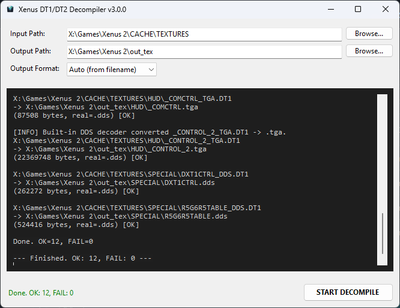

# Xenus DT1/DT2 Decompiler

[](../../releases/latest)
[](https://www.microsoft.com/windows)
[](https://dotnet.microsoft.com/download/dotnet/8.0)
[](https://github.com/CodeNoob53/xenus-dt1-decompiler/blob/main/LICENSE)
[](https://github.com/CodeNoob53/xenus-dt1-decompiler)

[English](README.md) | **Українська** | [Español](README_ES.md)

Витягує текстури з кешу ігор **Xenus 2: White Gold**, **Xenus: Точка кипіння (Boiling Point)** та **Предтечі (The Precursors)** (`*.DT1`) у `.tga`, `.dds`, `.png`, `.bmp` або `.jpg` зі збереженням структури папок.

Нічого встановлювати не треба: .NET вбудований в exe, а файли чи DLL гри не потрібні. Потрібна 64-бітна Windows 10 або 11.

---

## Швидкий старт

1. Завантажте останній архів зі сторінки **[Releases](../../releases/latest)** і розпакуйте його.
2. Запустіть `xenus-dt1-decompiler.exe`, виберіть папку гри `CACHE\TEXTURES` і натисніть **START DECOMPILE**.

---

## Де взяти кеш-файли

Гра зберігає ресурси в архівах `.grp`. Якщо в папці гри немає `CACHE\TEXTURES` з файлами `.DT1`, розпакуйте архіви утилітою **GrpUnpacker**. Вона входить до Vital Engine SDK, а також поширюється окремо. Деякі антивіруси на неї реагують, що типово для старих інструментів моддингу.

Розпакована гра потрібна й для того, щоб повернути змінені текстури (див. [Моддинг](#моддинг-як-повернути-текстури-в-гру)).

---

## Використання

### Графічний інтерфейс

Запустіть `xenus-dt1-decompiler.exe` без аргументів.

1. **Input Path** — папка з файлами `.DT1`, наприклад `Xenus 2\CACHE\TEXTURES`. Папку можна просто перетягнути на вікно. Вкладені папки теж обробляються.
2. **Output Path** — куди зберегти текстури (за замовчуванням `out_tex`).
3. **Output Format** — див. [Формати](#формати).
4. Натисніть **START DECOMPILE** і стежте за логом.



### Командний рядок

```
xenus-dt1-decompiler.exe <вхід> [вихідна_папка] [формат]
```

| Аргумент | За замовчуванням | Опис |
|---|---|---|
| `вхід` | — | Файл `.DT1` або папка для рекурсивного сканування |
| `вихідна_папка` | папка входу | Куди зберегти текстури |
| `формат` | auto | `tga`, `dds`, `png`, `bmp` або `jpg` |

```powershell
xenus-dt1-decompiler.exe "C:\Games\Xenus 2\CACHE\TEXTURES" ".\out"
xenus-dt1-decompiler.exe "C:\Games\Xenus 2\CACHE\TEXTURES" ".\out" png
```

`run_decompiler.bat` з архіву робить те саме зі шляхами, які достатньо вписати один раз. Командні рядки з версій 2.x, де передається `VELoader.dll` чи папка `MATERIALS`, теж працюють — ці аргументи просто ігноруються.

---

## Що виходить на виході

### Формати

| Формат | Результат |
|---|---|
| **Auto** *(рекомендовано)* | Формат, який текстура мала до кешування, — визначається за назвою: `KURSOR_1_TGA.DT1` → `KURSOR_1.tga`. Саме такий формат гра чекає, коли ви повертаєте текстуру. |
| `dds` | Текстура точно в тому вигляді, як вона лежить у кеші (всередині всі текстури — DDS). |
| `tga` / `png` / `bmp` / `jpg` | Конвертація вбудованим [texconv](https://github.com/microsoft/DirectXTex) (Microsoft, MIT). |

Якщо `texconv.exe` немає в папці програми, стиснені (DXT) текстури лишаються `.dds`.

### Що виправляється автоматично

- **Normal maps.** У кеші канали в них переставлені, тож текстури виглядають зеленими. Утиліта повертає стандартний RGB і розпізнає normal maps за пікселями — назви та файли матеріалів значення не мають.
- **`SPECIAL\DXT1CTRL` і `SPECIAL\R5G6R5TABLE`** — службові таблиці рушія, а не зображення. У режимі Auto вони зберігаються як оригінальний `.dds` — саме його треба повертати в гру. У `tga`/`png`/`bmp` з них виходить атлас для перегляду без втрат: не редагуйте його й не зберігайте в `jpg`.

### Які файли обробляються

Лише `.DT1`. Рушій створює ще `.DT2` (копія 64×64) і, для normal maps, `.DT3` (стиснена копія). Обидва — менш якісні дублікати `.DT1`.

---

## Моддинг: як повернути текстури в гру

Vital Engine 3 сам компілює окремі файли `.TGA` у кеш під час запуску гри, тож пакувальник не потрібен. Гра має бути розпакована GrpUnpacker (див. [Де взяти кеш-файли](#де-взяти-кеш-файли)).

**Заміна текстури**, наприклад `CACHE\TEXTURES\HUD\KURSOR_1_TGA.DT1`:

1. Витягніть її в режимі **Auto** → `KURSOR_1.tga`.
2. Відредагуйте. Для HUD-текстур та інших атласів зберігайте оригінальний розмір (див. *Розмір текстури* нижче).
3. Видаліть `KURSOR_1_TGA.DT1` і всі `.DT2` / `.DT3` з такою самою назвою з `CACHE\TEXTURES\HUD\`.
4. Покладіть `KURSOR_1.tga` у `<гра>\TEXTURES\HUD\`. Папку створіть самі — за замовчуванням її немає.
5. Запустіть гру. Рушій створить нові `KURSOR_1_TGA.DT1` / `.DT2` у `CACHE\TEXTURES\HUD\`.

**Додавання текстури** — так само, але з новою назвою; потім пропишіть її у відповідному файлі `.MAT`.

**Поширення мода** — роздавайте згенеровані файли `.DT1` / `.DT2`. Якщо гравець покладе їх у ту саму підпапку свого `CACHE\TEXTURES\`, вони матимуть пріоритет над архівами `.grp`.

> **Розмір текстури.** HUD-текстури, деякі 2D-спрайти й партикли — це атласи: XML-файли інтерфейсу посилаються на ділянки в них за піксельними координатами. Наприклад, фон компаса в `UI\PC\Planet\Scheme.xml` — це ділянка 167×150 у `_hud.tga`:
> ```xml
> <Material MaterialID="_hud">
>     <Position x="857" y="290"/>
>     <Size x="167" y="150"/>
> </Material>
> ```
> Якщо масштабуєте таку текстуру, помножте на той самий коефіцієнт усі `Position` і `Size`, що на неї посилаються, інакше HUD розсиплеться:
>
> 
>
> Решта текстур може бути до **2048×2048** (більші не скомпілюються); **1024×1024** — безпечний вибір.

Інструменти SDK **RF2View** і **levedit2** теж уміють компілювати текстури без запуску гри, але на сучасних системах їх важко запустити.

---

## Можливі проблеми

| Проблема | Що робити |
|---|---|
| Програма не запускається | Потрібна 64-бітна Windows 10 або 11. Версіям до 3.0.1 був потрібен ще .NET 8 Desktop Runtime x86 — просто завантажте останній реліз. |
| Попередження антивіруса (наприклад, Malwarebytes «Anomalous») | Програма з відкритим кодом, але без цифрового підпису, на що деякі сканери реагують. [Вихідний код](https://github.com/CodeNoob53/xenus-dt1-decompiler) можна переглянути й зібрати самостійно. |
| `texconv.exe not found`, текстури зберігаються як `.dds` | Тримайте `texconv.exe` з архіву поруч з exe. |
| `[FAIL] resource.DT1 : method 7 (encrypted) is not supported` | `resource.DT1` — це дані гри, а не текстура; на помилку можна не зважати. |

Знайшли помилку? [Створіть issue](https://github.com/CodeNoob53/xenus-dt1-decompiler/issues).

---

## Що нового у v3.0

- **`VELoader.dll` більше не потрібна.** Утиліта працює з будь-якою копією гри.
- **Виправляються всі normal maps.** Раніше частина пропускалась і лишалась зеленою. Поле **Materials** прибрано.
- **Службові таблиці `SPECIAL`** експортуються повністю і без втрат.
- **v3.0.2:** текстури Xenus: Точка кипіння знову розпаковуються (у 3.0.0–3.0.1 вони завершувались помилкою).
- **v3.0.1:** більше нічого не треба встановлювати — .NET тепер усередині exe.
- Простіший командний рядок: `<вхід> [вихідна_папка] [формат]`.

Усі версії з описами змін: **[Releases](../../releases)**.

---

## Ліцензія та подяки

MIT, див. [LICENSE](https://github.com/CodeNoob53/xenus-dt1-decompiler/blob/main/LICENSE). Вбудований `texconv.exe` — частина [DirectXTex](https://github.com/microsoft/DirectXTex) (Microsoft, MIT).

- **badmofo** — описав процес повернення текстур у гру ([RPGWatch Forums](https://rpgwatch.com/forum/threads/editing-the-in-game-textures.12577/)).
- [**@evgeniy-mapper**](https://github.com/evgeniy-mapper) — тестування та звіти про помилки з normal maps і службовими таблицями.
